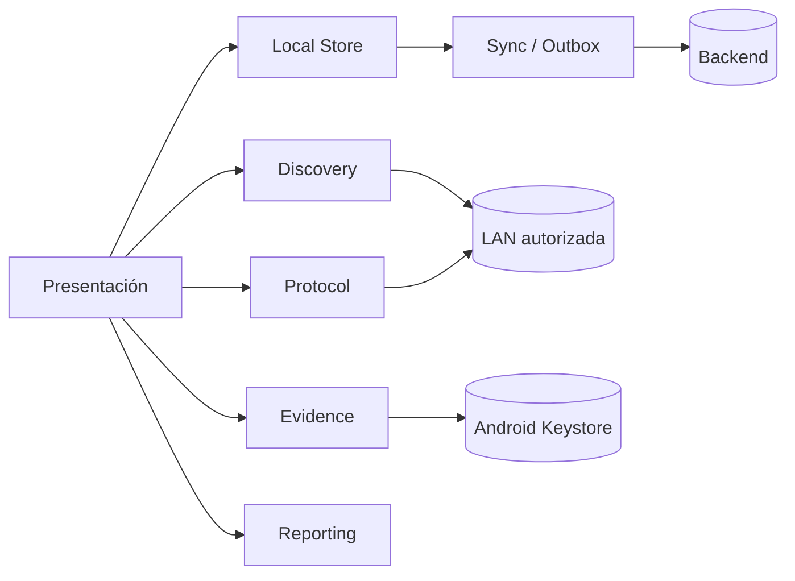
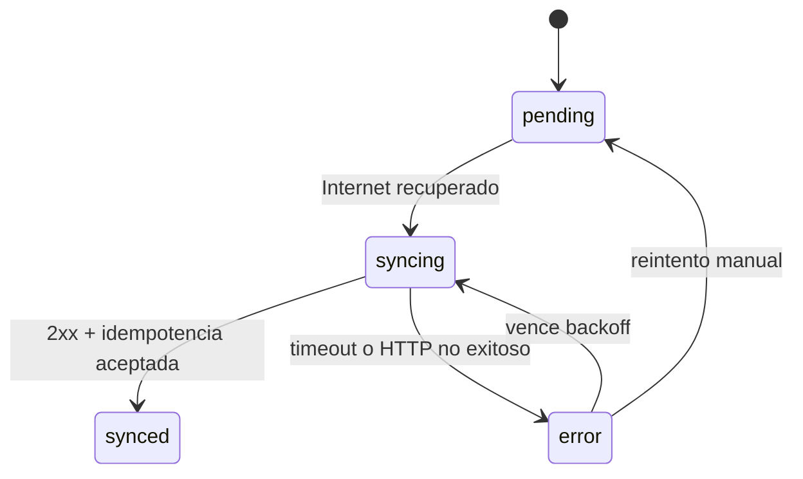

# Documento técnico - Network Diagnostics Suite

## 1. Alcance

La aplicación cubre RF-01 a RF-08 de la consigna. Su objetivo es conservar evidencia y resultados aun cuando no exista Internet, distinguiendo esa situación de la conectividad con equipos presentes en la LAN. La plataforma primaria es Android y el proyecto usa React Native CLI porque sockets, cámara, SQLite, PDF y SSH requieren módulos nativos.

## 2. Arquitectura

La capa de presentación solo coordina casos de uso. Discovery contiene mDNS y sondeo TCP. Protocol implementa SNMP y SSH. Evidence maneja cámara, GPS y secretos. Local Store encapsula NitroSQLite. Sync procesa la outbox. Reporting produce PDFs locales.

Se eligió NitroSQLite como alternativa equivalente a WatermelonDB. WatermelonDB agrega un protocolo de sincronización propio que no es necesario para el backend mínimo; NitroSQLite es compatible con React Native 0.87 y permite demostrar directamente transacciones, WAL, índices y la outbox. La primera alternativa evaluada, `react-native-sqlite-storage`, se descartó durante el build porque su script Android todavía invocaba `jcenter()`, eliminado en Gradle 9.

## 3. Descubrimiento de red

La app obtiene la dirección IPv4 de la Wi-Fi y limita el sondeo a su `/24`. Procesa hosts en lotes de 24 y prueba puertos TCP frecuentes (22, 53, 80, 443, 8080 y 8291). En paralelo crea navegadores mDNS para HTTP, SSH, estaciones y printers. Cada resultado se unifica por IP y queda persistido.

Android restringe el acceso de aplicaciones a la tabla ARP y a identificadores de capa 2. Por eso la ausencia de MAC se informa como tal. No se inventa una dirección ni se requiere root. El escaneo solo opera sobre la subred Wi-Fi actual.

## 4. Subconjunto SNMP

Se implementa SNMP v2c GetRequest/GetResponse sobre UDP. El módulo propio codifica y decodifica TLV BER con longitudes corta y larga, INTEGER, OCTET STRING, NULL, OBJECT IDENTIFIER, Counter32, Gauge32, TimeTicks y Counter64. Valida longitud, tipo de PDU, request-id y estado de error.

| Dato | OID MIB-II |
|---|---|
| sysUpTime | `1.3.6.1.2.1.1.3.0` |
| sysName | `1.3.6.1.2.1.1.5.0` |
| ifInOctets.N | `1.3.6.1.2.1.2.2.1.10.N` |
| ifOutOctets.N | `1.3.6.1.2.1.2.2.1.16.N` |

Un paquete se forma como `SEQUENCE(version, community, GetRequest(request-id, error-status, error-index, VarBindList))`. Cada VarBind contiene el OID y NULL. La respuesta esperada usa la etiqueta GetResponse `0xA2`. La comunidad se conserva en Keystore, aunque viaja sin cifrar por diseño del protocolo. SNMPv3 queda fuera del subset y es la opción recomendada para redes no confiables.

## 5. SSH

El cliente Android usa `com.github.mwiede:jsch`. La primera conexión obtiene la clave pública y muestra su huella SHA-256. El técnico debe compararla con una fuente confiable y aceptarla. La clave queda registrada en Keystore. Las conexiones operativas usan un repositorio `known_hosts` y `StrictHostKeyChecking=yes`; un cambio de clave cancela la sesión.

Solo se ofrecen comandos predefinidos para Linux, Cisco IOS y MikroTik. No existe una terminal libre. Usuario y contraseña se guardan con `WHEN_UNLOCKED_THIS_DEVICE_ONLY` y nunca se incluyen en SQLite, reportes, logs ni sincronizaciones.

## 6. Evidencia y reportes

VisionCamera captura fotos y decodifica QR, EAN, Code 39 y Code 128. Geolocation Service solicita una lectura GPS de alta precisión con timeout. La instalación exige sitio, equipo y coordenadas; admite notas, IP asociada y varias fotos.

El PDF se renderiza desde HTML local, incluye identificación, fecha, coordenadas, precisión, observaciones, diagnósticos y fotografías. No realiza solicitudes de red. Android Share Sheet permite abrirlo o compartirlo.

## 7. Persistencia offline y outbox

NitroSQLite usa claves UUID, foreign keys, WAL e índices. Las tablas principales son `devices`, `diagnostics`, `installations` y `outbox`. Guardar una entidad y crear su acción pendiente se realiza dentro del flujo local antes de intentar Internet.

El backoff es exponencial desde 10 segundos hasta 5 minutos. Cada acción posee `Idempotency-Key`. El backend conserva la respuesta asociada a la clave para que una repetición no duplique datos. Si el servidor ya posee una versión con `updatedAt` posterior, aplica resolución básica `server-wins` y devuelve el conflicto resuelto.

NetInfo diferencia Wi-Fi local de acceso a Internet. La recuperación de Internet dispara `syncPending`, pero SNMP/SSH dependen de que el equipo objetivo sea alcanzable en la LAN.

## 8. Backend

Express expone:

- `GET /health`: disponibilidad y cantidad de entidades.
- `POST /api/sync`: valida con Zod, exige `Idempotency-Key`, realiza upsert y resuelve conflictos.
- `GET /api/entities?type=installation`: inspección académica de datos recibidos.

Escucha en `0.0.0.0:3001`. El backend es un stub en memoria admitido por la consigna; al reiniciarlo se borra su contenido. La idempotencia cubre la vida del proceso.

## 9. Seguridad y permisos

El manifiesto declara Internet, estado de red, Wi-Fi/multicast, cámara, ubicación y Nearby Wi-Fi Devices. Los permisos sensibles se solicitan al usar la función. No existen credenciales privadas en el repositorio. La política de red bloquea HTTP claro salvo `10.0.2.2` y localhost para el laboratorio. Un teléfono físico usa `adb reverse`; cualquier backend remoto debe usar TLS.

## 10. Pruebas ejecutadas

| Prueba | Tipo | Resultado verificable |
|---|---|---|
| Codificación GetRequest | Jest automatizada | Pasa |
| Decodificación GetResponse sysName | Jest automatizada | Pasa |
| Rechazo BER truncado | Jest automatizada | Pasa |
| Health del backend | Supertest | Pasa |
| Idempotencia | Supertest | Pasa |
| TypeScript | `tsc --noEmit` | Pasa |
| Build Android | Gradle `assembleRelease` | Pasa; APK v1.0 generada |

Las pruebas físicas no se declaran aprobadas hasta ejecutarlas en el equipo del estudiante. El procedimiento reproducible está en `VALIDACION_FISICA.md`.

## 11. Dependencias principales

React Native 0.87.1; React Navigation; NitroSQLite; NetInfo; react-native-udp; react-native-tcp-socket; react-native-zeroconf; VisionCamera; Geolocation Service; Keychain; HTML to PDF; JSch; Express y Zod.

## 12. Referencias

RFC 1157, RFC 1213, documentación de React Native, NitroSQLite, VisionCamera, JSch y OWASP Mobile Application Security.
